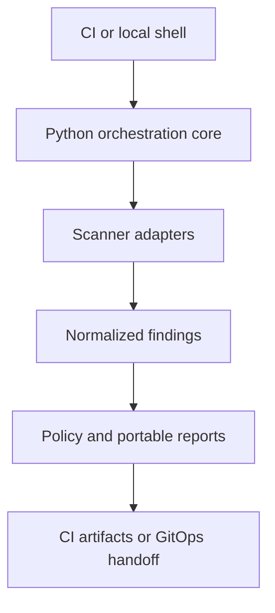

# SecWeaver architecture

<!-- markdownlint-disable MD013 -->

SecWeaver is a CI-neutral orchestration layer for repeatable security scans. It
does not replace the scanners it runs, a build system, a deployment controller,
or a security review.

The project code and SecWeaver-owned baseline rules are licensed under 0BSD.
Every third-party scanner, database, rule pack, container image, and optional
analyzer keeps its own license and terms.

## Design goals

- Keep scanner behavior consistent across GitHub, GitLab, Bitbucket, Gitea,
  Forgejo, Woodpecker CI, and generic CI runners.
- Run the same Python core locally and in CI.
- Support native tools and isolated container execution where an adapter is
  implemented.
- Use local, reviewable configuration and rules.
- Produce portable reports rather than depending on one vendor's security UI.
- Keep public configuration free of company names, endpoints, credentials,
  internal paths, and private policy.
- Fail distinctly for policy findings, bad configuration, and scanner
  infrastructure failures.

## Four independent dimensions

SecWeaver uses four terms that must not be treated as synonyms:

| Dimension | Meaning | Example |
| --- | --- | --- |
| Runner OS | The operating system executing Python and scanner processes | A Windows Server self-hosted runner |
| Target OS | The operating system for which an artifact was built | A Linux OCI image built on a macOS runner |
| Source language | A language detected from repository files | Kotlin source in an Android project |
| Artifact | A concrete scan target produced or selected by the pipeline | Source tree, OCI image, APK, AAB, archive, or SBOM |

Running SecWeaver on an operating system does not prove complete vulnerability
coverage for that operating system. Likewise, detecting a source language does
not prove that every dependency format or vulnerability class for that
language is understood.

## Component flow

Provider-specific CI files should remain thin. Their responsibility is to
prepare Python and scanners, invoke `secweaver`, preserve its exit code, and
upload the report directory. Detection, scanner arguments, normalization, and
policy belong in the shared core.

## Implemented core

The current Python 3.11+ core provides:

- layered TOML configuration;
- bounded environment-variable overrides;
- source-directory and OCI-image target selection;
- native, container, and automatic execution selection;
- scanner execution without a command shell;
- bounded parallelism and per-scanner timeouts;
- a reduced scanner environment and isolated runtime home;
- read-only source mounts, dropped capabilities, read-only container
  filesystems, and `no-new-privileges` for container execution;
- parsing and normalization for Gitleaks, Trivy, Opengrep, and OSV-Scanner;
- CycloneDX SBOM generation through Trivy;
- advisory, balanced, and strict policy profiles;
- sanitized JSON, Markdown, JUnit XML, and SARIF summaries;
- a SHA-256 report manifest.

The configured scanners run concurrently, subject to `scan.parallelism`.
SecWeaver does not currently implement an internal stage graph for dependency
installation, compilation, unit tests, DAST, signing, or deployment. A CI
pipeline may place those operations before or after SecWeaver, but documentation
and badges must not imply that SecWeaver performed them.

## Implemented scanner applicability

| Scanner | Source target | Image target | Current output consumed by core |
| --- | --- | --- | --- |
| Gitleaks | Yes | No | JSON |
| Trivy | Yes | Yes | JSON |
| Opengrep | Yes | No | SARIF 2.1.0 |
| OSV-Scanner | Yes | Yes | JSON |
| Trivy SBOM job | Yes | Yes | CycloneDX JSON |

For source targets, Gitleaks uses Git history when `scan.history = true` and a
directory scan otherwise. Opengrep uses only explicitly configured local rule
paths; the shipped default is `builtin:baseline`.

The current Opengrep adapter is native-only. Selecting container-only execution
therefore makes Opengrep unavailable unless a container adapter is added in
code. Gitleaks, Trivy, and OSV source scans have container command definitions;
the current OSV image scan is native-only.

## Configuration order

Configuration is resolved in this order:

1. built-in defaults;
2. selected built-in profile;
3. each `--config` file, in command-line order;
4. supported `SECWEAVER_*` environment overrides;
5. explicit CLI overrides.

Normally, later values win. Two global CLI controls deliberately change that
behavior:

- `--profile NAME` is re-applied after files, environment, and scan overrides.
  It locks the selected profile name, its complete `[policy]` table, and its
  required-scanner set. Other scan inputs remain caller-controlled.
- `--no-project-config` prevents automatic discovery of `secweaver.toml`.
  The shipped provider templates use it so pull-request content cannot weaken
  the trusted policy. It is mutually exclusive with `--config`.

For a protected company policy, either use an explicit trusted `--config`
overlay and control all later environment/CLI inputs, or use the profile lock
and keep any repository-specific settings in the trusted runner template.

SecWeaver validates known scanners, supported profiles, target types, execution
modes, timeouts, and policy values. It does not cryptographically verify
configuration signatures. Profile locking protects only the fields listed
above; paths, target selection, execution mode, history, offline behavior,
retention, enabled scanners, and rule inputs must still be controlled by the
trusted pipeline.

## Trust boundaries

Treat repository content, scanner output, dependency metadata, archives, and
pull-request configuration as untrusted input.

- Do not expose protected credentials to fork or untrusted merge-request jobs.
- Prefer disposable runners for builds that execute repository code.
- Use a read-only checkout for scan-only jobs.
- Do not give scan-only jobs a production deployment token.
- Review scanner and rule updates before promotion.
- Apply CPU, memory, storage, and timeout limits outside SecWeaver as well as
  the built-in process timeout.
- Store reports as private CI artifacts unless their contents have been
  reviewed for publication.

SecWeaver invokes scanners with `shell=False` and restricts report paths to the
workspace. Scanner output is first written to a private temporary directory;
only a fixed set of validated report and log paths can be copied into the
public artifact directory. These controls reduce command and path risks; they
do not make an untrusted build safe. Native scanner binaries remain trusted
code, and version-string matching is not a substitute for runner provenance,
package signatures, or approved binary checksums. A malicious native process
with the runner's filesystem identity can still race user-space validation or
detach a child; enforce process, filesystem, and network isolation at the
runner boundary and configure artifact publishers to include only the
documented report filenames where the CI product permits it.

## CI and CD boundary

GitHub Actions, GitLab CI/CD, Bitbucket Pipelines, Gitea Actions, Forgejo
Actions, Woodpecker CI, Jenkins, and other systems are execution environments.
An adapter is considered supported only to the level stated by its tests and
documentation. Similar YAML syntax is not proof of full behavioral
compatibility between providers.

Argo CD is a continuous-delivery controller, not a source scanner or general CI
runner. A recommended handoff is:

1. CI scans and builds an artifact.
2. CI records the immutable artifact digest and retains reports.
3. A reviewed change updates a separate GitOps repository.
4. Argo CD reconciles the approved desired state.

SecWeaver does not currently create that GitOps change, sign the artifact, or
operate Argo CD.

## Extension points

The intended extension boundaries are:

- language catalog entries;
- SecWeaver-owned Opengrep rules;
- private rule paths supplied by an organization overlay;
- scanner adapters and report parsers;
- CI templates;
- optional ecosystem analyzer jobs;
- provider-specific report upload or conversion steps.

The present scanner set is validated explicitly in Python; it is not yet a
dynamic plug-in registry. Adding a core scanner requires an adapter, report
parser, configuration entry, policy behavior, sanitization rules, and tests.
